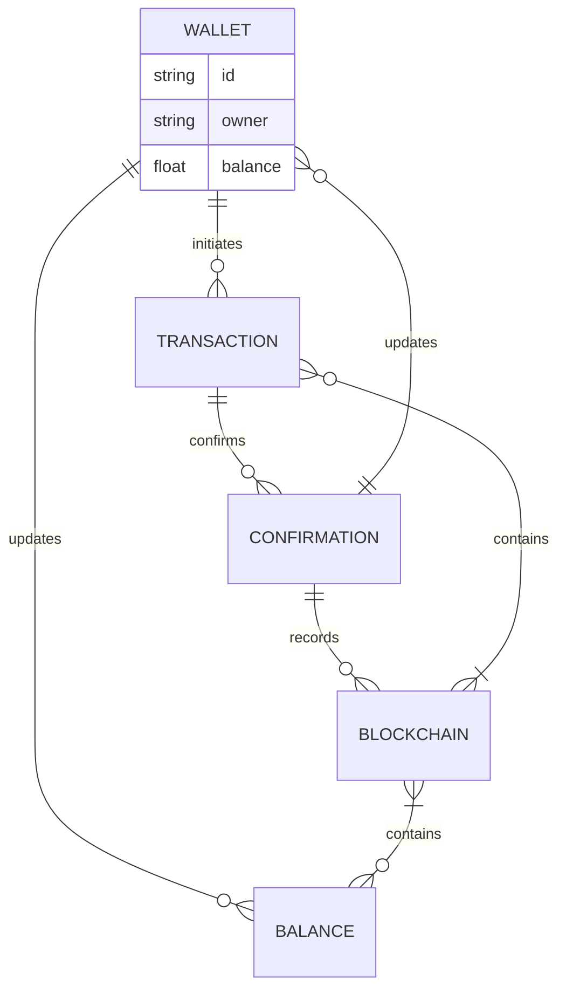

<!-- EN -->
## EN

  <i align="center">Building System Applications with C# & C++ 🚀</i>

## README LANGUAGE

    LANGUAGES!

---------------------------------  
  
## Read About
A Crypto Tracker is a tool or application designed to monitor cryptocurrency prices and market trends in real-time. It provides users with up-to-date information on various digital assets, including price changes, market capitalization, and trading volumes. Crypto Trackers help investors make informed decisions by offering insights into market performance, portfolio value, and historical data, enhancing their trading and investment strategies.

#### **Please ReaD First What You Need Part.**
#### 
(<a href="#what-you-need-1">WHAT YOU NEED</a>)
 

### What You Need
----
                    
| Explorer      | Api |
| --------- | -----:|
| Blockchain  | 0000 |
| Etherscan     |   Daf |
| Oklink      |    000 |
| BlockCypher |    ST8 |
| Explorer-Solana |    91 |
                
